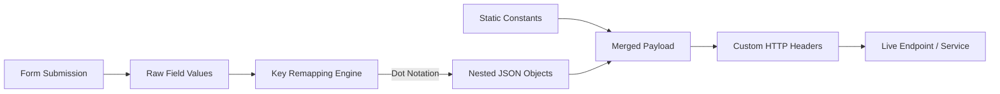

# ShadForm ⚡

> **`shadform`** — Modern, 100% TypeScript drag-and-drop form builder, multi-step wizard, and runtime renderer built on **shadcn/ui**, **Tailwind CSS**, **React Hook Form**, and **Zod**.

[](LICENSE)
[](https://www.typescriptlang.org/)
[](https://react.dev/)
[](https://tailwindcss.com/)

---

## ✨ Features

- 🎯 **Visual Drag-and-Drop Form Builder**: Clean, single-header studio navbar with live canvas, drag-and-drop element palette, and property inspector.
- 🚀 **Zero-Baggage Form Renderer**: Separate, lightweight runtime component `<FormRenderer />` that renders schemas with zero builder overhead.
- 📐 **Responsive 4-Tier Layout Grid**:
  $$\text{Multi-Step Pages} \longrightarrow \text{Rows} \longrightarrow \text{Columns (1-12)} \longrightarrow \text{Fields}$$
  Supports custom widths (`50:50`, `33:33:33`, `25:75`, etc.), sub-columns, and native CSS container queries (`@container`).
- 🎨 **Shadcn UI & Zinc Aesthetic**: Built natively on Radix UI primitives and styled with Tailwind design tokens. Complete dark & light mode support out of the box.
- 🔀 **Conditional Logic & Step Branching**:
  - Show/hide, enable/disable, or require fields dynamically based on user inputs.
  - Multi-step wizard branching: route users dynamically to different pages based on their answers.
- 🔒 **Dynamic Zod Validation**: Generates type-safe Zod validation schemas for active, visible form fields at runtime.
- ⚡ **Webhook Pipeline & Payload Remapping**: Live test webhook dispatcher, latency analyzer, cURL snippet generator, and key-remapping engine.
- 📊 **Submissions Manager**: In-app submission records viewer, search, and one-click export to CSV & JSON.
- 📦 **Subpath Exports**: Clean modular exports for `shadform`, `shadform/renderer`, and `shadform/core`.
- ⏪ **Undo / Redo History**: Full state history stack with keyboard shortcuts (`Ctrl+Z` / `Ctrl+Y`).
- 🔄 **Portable JSON Schema**: Import, export, and embed schemas anywhere.

---

## 📦 Installation

```bash
npm install shadform zod react-hook-form
# or with pnpm
pnpm add shadform zod react-hook-form
# or with yarn
yarn add shadform zod react-hook-form
```

Ensure Tailwind CSS is configured in your project (standard shadcn/ui setup).

---

## 🚀 Quick Start

### 1. Visual Form Builder (`<FormBuilder />`)

Embed the full visual studio directly into your application or admin panel:

```tsx
import React, { useState } from 'react'
import { FormBuilder } from 'shadform'
import { FormBuilderSchema } from 'shadform/core'
import 'shadform/style.css'

export function FormBuilderPage() {
  const [schema, setSchema] = useState<FormBuilderSchema>()

  return (
    <div className="h-screen w-full">
      <FormBuilder
        initialSchema={schema}
        onChange={(updatedSchema) => {
          setSchema(updatedSchema)
        }}
      />
    </div>
  )
}
```

### 2. Runtime Form Renderer (`<FormRenderer />`)

Render saved schemas for consumers without loading the builder bundle:

```tsx
import React from 'react'
import { FormRenderer } from 'shadform/renderer'
import { FormBuilderSchema } from 'shadform/core'
import 'shadform/style.css'

export function ConsumerForm({ schema }: { schema: FormBuilderSchema }) {
  const handleSubmit = (values: Record<string, unknown>) => {
    console.log('Submitted Form Values:', values)
  }

  return (
    <div className="max-w-2xl mx-auto py-10">
      <FormRenderer
        schema={schema}
        onSubmit={handleSubmit}
      />
    </div>
  )
}
```

---

## 🏗️ Subpath Exports

| Export Path | Content & Purpose |
| :--- | :--- |
| `shadform` | Main entry point containing `<FormBuilder />`, `<HeaderBar />`, and studio shell. |
| `shadform/renderer` | Lightweight runtime renderer (`<FormRenderer />`, `<FormFieldRenderer />`, `useFormEngine`). |
| `shadform/core` | Pure TypeScript schemas, types, Zod generators, webhook remapping, and normalization. |
| `shadform/editor` | Visual editor components (`Canvas`, `PaletteSidebar`, `PropertiesPanel`, `useBuilderStore`). |
| `shadform/style.css` | Compiled standalone CSS stylesheets. |

---

## ⚡ Webhook Engine & Creative Integrations

ShadForm features a built-in webhook pipeline that transforms, enriches, and dispatches form responses directly to any backend, API, or third-party service without requiring intermediate glue code.

### 1. Webhook Pipeline Architecture



### 2. Configuration Specification (`WebhookConfig`)

Configure webhooks visually in the **Webhook Dialog** or programmatically via schema settings:

```typescript
export interface WebhookConfig {
  enabled: boolean
  url: string
  method: 'POST' | 'PUT'
  headers?: Record<string, string>       // e.g. Authorization: "Bearer sk_...", X-API-Key
  keyMapping?: Record<string, string>    // Map field IDs to clean keys or dot-notation paths
  staticPayload?: Record<string, unknown>// Inject constant metadata into every payload
}
```

#### Dynamic Dot-Notation Key Remapping
Raw field IDs (e.g. `field_email_123`) can be remapped directly to nested JSON structures:

* **Before (Raw Submission)**:
  ```json
  {
    "field_email_123": "alex@acme.com",
    "field_first_456": "Alex",
    "field_last_789": "Morgan"
  }
  ```
* **Key Mapping Rule**:
  ```json
  {
    "field_email_123": "user.contact.email",
    "field_first_456": "user.profile.firstName",
    "field_last_789": "user.profile.lastName"
  }
  ```
* **After (Remapped Outgoing Payload)**:
  ```json
  {
    "user": {
      "contact": { "email": "alex@acme.com" },
      "profile": { "firstName": "Alex", "lastName": "Morgan" }
    }
  }
  ```

---

### 3. Creative Integration Recipes

#### Recipe 1: Direct Discord / Slack Alerts (Zero Backend Needed)
Send real-time alerts into your team's Slack or Discord channel without deploying a server:

* **Endpoint URL**: `https://discord.com/api/webhooks/YOUR_WEBHOOK_ID/YOUR_TOKEN`
* **Key Remapping**:
  * Remap your feedback/message field $\to$ `"content"`
* **Static Payload**:
  ```json
  {
    "username": "ShadForm Notifier",
    "avatar_url": "https://raw.githubusercontent.com/code-simply/formforge/main/public/icon.png"
  }
  ```

---

#### Recipe 2: AI Agent & LLM Automation Pipeline
Connect form responses directly to an AI agent (e.g., OpenAI, Anthropic, or Google Gemini) for automated sentiment analysis, classification, and auto-drafted replies:

* **Endpoint URL**: `https://api.your-agent-service.com/v1/analyze`
* **Custom Headers**:
  ```http
  Authorization: Bearer sk-your-api-key
  X-AI-Model: gemini-1.5-pro
  ```
* **Key Remapping**:
  * `field_feedback` $\to$ `"user_prompt"`
* **Static Payload**:
  ```json
  {
    "task": "sentiment_analysis_and_auto_reply",
    "max_tokens": 500,
    "temperature": 0.2
  }
  ```

---

#### Recipe 3: Multi-App Automations (Zapier / Make.com / n8n)
Trigger complex multi-stage workflows across Google Sheets, HubSpot, Notion, and Gmail:

* **Endpoint URL**: `https://hooks.zapier.com/hooks/catch/123456/abcdef/`
* **Key Remapping**:
  * Remap internal IDs to clean camelCase (`fullName`, `workEmail`, `teamSize`)
* **Static Payload**:
  ```json
  {
    "source": "landing_page_waitlist",
    "campaign": "launch_v1",
    "environment": "production"
  }
  ```

---

#### Recipe 4: Next.js API Route + Database Ingestion (Prisma / Supabase)
Securely ingest responses into PostgreSQL, Supabase, or MongoDB:

```typescript
// app/api/webhooks/form/route.ts
import { NextResponse } from 'next/server'
import { createClient } from '@supabase/supabase-js'

const supabase = createClient(process.env.SUPABASE_URL!, process.env.SUPABASE_KEY!)

export async function POST(req: Request) {
  // 1. Verify custom webhook header
  const signature = req.headers.get('x-webhook-secret')
  if (signature !== process.env.FORM_WEBHOOK_SECRET) {
    return NextResponse.json({ error: 'Unauthorized' }, { status: 401 })
  }

  // 2. Insert remapped payload directly into database
  const payload = await req.json()
  const { data, error } = await supabase.from('leads').insert(payload)

  if (error) {
    return NextResponse.json({ error: error.message }, { status: 500 })
  }

  return NextResponse.json({ success: true, id: data?.[0]?.id }, { status: 200 })
}
```

---

### 4. Programmatic Webhook Utilities

Use the core webhook engine directly in your own code:

```typescript
import { remapFormPayload, sendWebhookPayload, generateCurlSnippet } from 'shadform/core'

const rawValues = {
  field_name: 'John Doe',
  field_email: 'john@example.com'
}

const config = {
  enabled: true,
  url: 'https://api.example.com/leads',
  method: 'POST' as const,
  headers: { 'Authorization': 'Bearer my_token' },
  keyMapping: {
    field_name: 'contact.name',
    field_email: 'contact.email'
  },
  staticPayload: {
    leadSource: 'organic_web'
  }
}

// 1. Transform raw values into clean nested payload
const cleanPayload = remapFormPayload(rawValues, config.keyMapping, config.staticPayload)

// 2. Dispatch payload with live latency & status tracking
const result = await sendWebhookPayload(config, rawValues)
console.log(result.status)  // 200
console.log(result.message) // 'Webhook delivered successfully'

// 3. Generate ready-to-run terminal cURL snippet for debugging
const curlCommand = generateCurlSnippet(config, rawValues)
console.log(curlCommand)
```

---

### 5. In-Studio Live Inspector & Terminal cURL Testing

The built-in **Webhook Dialog** in `<FormBuilder />` provides:
- **Send Test Payload Button**: Fires a live HTTP request to your configured endpoint using your current canvas form values.
- **Real-Time Latency Meter**: Measures response time in milliseconds (e.g. `142ms`).
- **HTTP Status Badge**: Shows `200 OK` (green) or error codes (`400 Bad Request`, `500 Server Error`).
- **Response Headers & Body Inspector**: Inspects return data directly inside the studio.
- **Copy cURL Command**: Generates an exact, executable `curl -X POST ...` command snippet for terminal testing.

---

## 🛠️ Development & Contributing

Contributions are warmly welcomed! Anyone can clone the repository, run the development environment, and contribute:

```bash
# Clone the repository
git clone https://github.com/code-simply/formforge.git
cd formforge

# Install dependencies
npm install

# Start local interactive studio
npm run dev

# Run test suite (59 unit tests)
npm test

# Build production library distribution
npm run build
```

---

## 📄 License

MIT © [Parthiban (code-simply)](https://github.com/code-simply)
